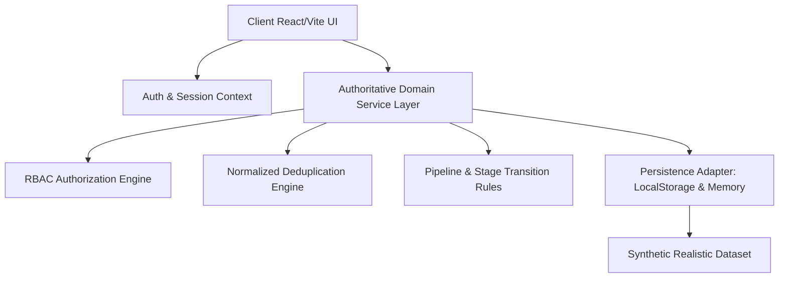

# OJIX ClientFlow — Architecture & Domain Specification

## 1. System Overview
**OJIX ClientFlow** is an operational CRM & Follow-up Operating System designed for freelancers, service agencies, and agile sales teams. It bridges the gap between disorganized notes and heavy enterprise CRMs by offering an intuitive, high-velocity pipeline with strict follow-up accountability and role-based access control (RBAC).



---

## 2. Trust Boundaries & Role-Based Access Control (RBAC)

The system defines 4 distinct roles with access boundaries enforced at the domain service layer:

| Resource / Action | Workspace Admin | Sales / Account Owner | Team Member | Viewer |
| :--- | :---: | :---: | :---: | :---: |
| **View Pipeline & Dashboard** | Full Workspace | Full Workspace | Assigned / Shared | Full Workspace (Read-only) |
| **Create Contact / Deal** | Allowed | Allowed | Allowed | **DENIED** |
| **Edit Assigned Record** | Allowed | Allowed | Allowed | **DENIED** |
| **Edit Unassigned Record** | Allowed | **DENIED** | **DENIED** | **DENIED** |
| **Move Deal Stage** | Allowed | Allowed (Assigned) | Allowed (Assigned) | **DENIED** |
| **Manage Team & Settings** | Allowed | **DENIED** | **DENIED** | **DENIED** |
| **Delete Record** | Allowed | Allowed (Assigned) | **DENIED** | **DENIED** |

> [!IMPORTANT]
> **Data Layer Enforcement**: UI visibility alone is never treated as security. Every data operation in `src/services/store.ts` passes through `canUserPerform(currentUser, action, resource)` before executing.

---

## 3. Domain Entities & Data Contracts

### 3.1 Contact
```typescript
interface Contact {
  id: string;
  workspaceId: string;
  name: string;
  email: string; // Case-insensitive normalized for deduplication
  phone: string;
  organizationId?: string;
  organizationName?: string;
  source: 'Referral' | 'Inbound' | 'Outbound' | 'Event' | 'Website' | 'Other';
  ownerId: string;
  ownerName: string;
  tags: string[];
  createdAt: string;
  updatedAt: string;
}
```

### 3.2 Deal / Lead Opportunity
```typescript
type DealStage = 'lead' | 'qualified' | 'discovery' | 'proposal' | 'negotiation' | 'won' | 'lost';

interface Deal {
  id: string;
  workspaceId: string;
  title: string;
  contactId: string;
  contactName: string;
  organizationName?: string;
  stage: DealStage;
  estimatedValue: number;
  currency: string;
  expectedCloseDate: string; // YYYY-MM-DD
  nextAction: string;
  nextActionDate: string; // YYYY-MM-DD
  ownerId: string;
  ownerName: string;
  tags: string[];
  createdAt: string;
  updatedAt: string;
  lastActivityAt: string;
}
```

### 3.3 Activity Record (Audit & Timeline)
```typescript
type ActivityType = 'note' | 'call' | 'meeting' | 'stage_change' | 'followup_scheduled' | 'created';

interface Activity {
  id: string;
  workspaceId: string;
  dealId?: string;
  contactId?: string;
  type: ActivityType;
  title: string;
  description: string;
  performedByUserId: string;
  performedByUserName: string;
  createdAt: string;
}
```

---

## 4. Key Architectural Patterns

1. **Normalized Deduplication**:
   - Compares incoming emails after `trim().toLowerCase()`.
   - Returns a structured conflict warning: `{ isDuplicate: boolean, existingRecordId?: string, message?: string }`.
   - Never silently merges or discards records.

2. **Stage Progression & Stale Deal Identification**:
   - Pipeline stages are linearly ordered with validation ensuring deals cannot jump into undefined stages.
   - Any open deal without activity for >14 days is flagged as **Stale** on the dashboard.

3. **Timezone-Aware Follow-up Classification**:
   - Compares `nextActionDate` with the user's active calendar day:
     - `nextActionDate < today`: **Overdue** (marked with alert badges)
     - `nextActionDate === today`: **Due Today**
     - `nextActionDate > today`: **Upcoming**

4. **Synthetic Data Isolation**:
   - Zero real personal data. Pre-loaded with realistic synthetic companies (e.g. Apex Design, Lumina Tech, Vertex Logistics) and personas.
